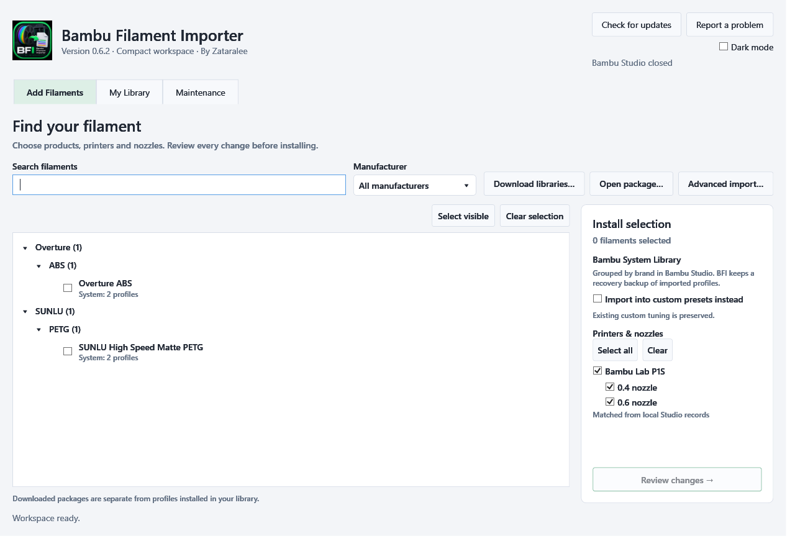
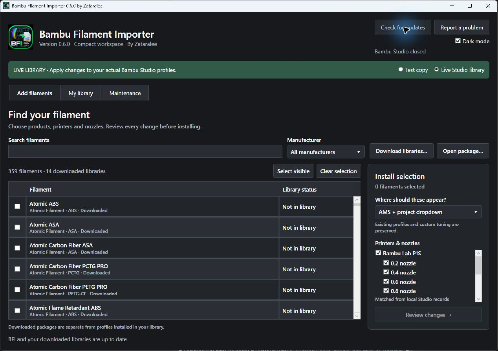

# Bambu Filament Importer

**Version 0.6.0 | By Zataralee**

<p align="center"></p>

A native Windows desktop utility for importing, organizing, editing, backing up, and removing manufacturer filament profiles in Bambu Studio.

[Download the latest release](../../releases/latest) | [Report a problem](../../issues/new/choose) | [Request a filament profile](../../issues/new/choose)



## Why This Exists

Bambu Studio stores filament presets in several locations and associates system presets with compatible printer definitions. Bambu Filament Importer provides one manufacturer-level `.bflib` package while generating the required per-printer profiles at installation time.

The importer identifies locally registered printer models from the user's own Bambu Studio configuration, then uses enabled machine presets only as a clearly labeled fallback. A package is therefore not tied to the original developer's printers.

## Available Libraries

BFI's online catalog currently provides 17 independently downloadable manufacturer packages containing 423 product families. Libraries are selected inside BFI and are not bundled with the application download.

| Manufacturer | Products |
| --- | ---: |
| SUNLU | 40 |
| Polymaker | 48 |
| eSUN | 36 |
| ELEGOO | 32 |
| colorFabb | 29 |
| TINMORRY | 28 |
| Proto-pasta | 27 |
| Fiberlogy | 25 |
| Siraya Tech | 23 |
| Creality | 22 |
| Prusament | 22 |
| Spectrum Filaments | 22 |
| Fillamentum | 20 |
| MatterHackers | 16 |
| Overture | 14 |
| Atomic Filament | 11 |
| HATCHBOX | 8 |

Official source references and catalog policy are documented in [catalogs/README.md](catalogs/README.md). Product families are represented once; color variants are not separate presets.

## Features

- Imports printer-neutral manufacturer libraries to selected Bambu Studio printer models.
- Reads locally registered printer models from Bambu Studio and excludes unrelated enabled presets when device records are available; future-model inferences are labeled and left unchecked for review.
- Recognizes H2C, H2D, H2D Pro, and H2S devices, including shared H-series identifiers resolved against locally enabled machine presets.
- Compares actual `compatible_printers` coverage and generates only missing profiles.
- Handles Bambu's P1S/P1P live-device identity crossover so P1-family profiles remain visible in the AMS material picker.
- Imports to the Device/AMS catalog, Project Library, or both.
- Provides a compact workspace with **Add filaments**, **My library**, and **Maintenance**.
- Searches across downloaded manufacturers and reviews a combined selection before installation.
- Groups the current library by product with an explicit printer-profile choice before editing.
- Displays and edits direct and inherited temperatures, cooling, drying, flow, retraction, and calibration values.
- Removes individual profiles from My library; advanced rename and bulk removal tools are available in Maintenance.
- Detects duplicates and preserves existing compatible Bambu presets.
- Selects or deselects every filament in a loaded package with one command.
- Audits and repairs AMS filament IDs that are too long or collide after printer synchronization.
- Creates complete `.bflbackup` library backups and merges them during restoration.
- Creates safety backups before changing Bambu Studio files.
- Validates the complete catalog before and after installation and rolls back a failed write automatically.
- Monitors Bambu Studio continuously, pauses live writes while it is open, and refreshes local records when it closes (without discarding unsaved edits).
- Offers the existing catalog-drift repair tools through Maintenance → Advanced library tools.
- Provides an optional separate test copy for trying imports, edits, and restores without changing Studio.
- Checks for BFI and filament-library updates at startup without installing either automatically.
- Presents a selectable manufacturer catalog so users download only the libraries they want.
- Notifies existing users only about updates to installed libraries and separately announces newly published libraries.
- Checks and installs manufacturer library updates independently from application updates, with package hashes and rollback protection.
- Keeps one managed manufacturer library folder in Local AppData so portable BFI copies do not create competing catalogs in Downloads or other launch folders.
- Checks GitHub Releases and installs confirmed updates in place.
- Keeps 14 days of local BFI activity and error logs and creates a sanitized diagnostic ZIP from the Report Bug dialog.
- Supports persistent light and dark modes.

BFI does not connect to Bambu printers or Bambu Cloud. Local Bambu Studio device identifiers are read only to identify printer models and redact diagnostics; they are never displayed, logged, included in reports, or transmitted. At startup, BFI checks this repository for the latest application release and manufacturer-library index. Package files are downloaded only after the user selects libraries and confirms the download.

The **Report Bug** action creates a local ZIP containing the user's report, a version and printer-model summary, and optional sanitized BFI logs. Bambu Studio configuration files are never included. Known usernames, local user paths, IP addresses, printer serial numbers, and access codes are removed. BFI then opens GitHub and selects the ZIP in Explorer, but the user must review and attach it; nothing is uploaded automatically. Local BFI logs are retained for 14 days under `%LOCALAPPDATA%\BambuFilamentImporter\Logs`.



## Getting Started

1. Download the current Windows release and extract it to a normal writable folder.
2. Close Bambu Studio.
3. Start `BambuFilamentImporter.exe`.
4. Select **Download libraries…**, choose the manufacturers you want, and download them.
5. In **Add filaments**, search and select products across your downloaded libraries.
6. Choose the destination, printers, and nozzles in the selection panel.
7. Select **Review changes**, then **Install into Bambu Studio**. BFI creates a backup first.

Use **My library** to choose a product and its exact printer profile before editing. **Maintenance** contains backups, health checks, and advanced tools. To try changes separately, select **Test copy**; this copy persists until you refresh it from Studio.

BFI checks for application and filament-library updates at startup. **Check for updates** repeats both checks. Application releases, downloaded library updates, and newly available manufacturers have separate notices. Downloading a package refreshes the available products; it does not overwrite installed profiles or your tuning. Choose new products or missing printer coverage and review before installing.

Existing users can install v0.6.0 from the update notice in their current BFI. The updater keeps the managed package library, notification history, theme preference, and Studio profiles.

Use **Report a problem** in the header to create a sanitized diagnostic package when reporting a problem. Paste the copied report into the GitHub page and drag the selected ZIP onto the issue.

Program Files mirroring requires Administrator access. Normal roaming-catalog and Project Library imports do not.

## Safety

Manufacturer temperature ranges are starting points. Flow ratio and maximum volumetric speed require calibration for the individual printer, nozzle, and spool. Abrasive composites require appropriate hardened components and nozzle size.

Back up the library before extensive changes. Maintenance can create and restore complete `.bflbackup` files. Changes in the compact workspace also create automatic backups.

## `.bflib` Format

A `.bflib` file is a ZIP archive containing:

- `manifest.json`
- `LIBRARY_LICENSE.md`
- printer-neutral manufacturer filament JSON files listed by the manifest
- official source URLs and package compatibility notes in the manifest

The package does not contain hard-coded printer names. The importer creates compatible child profiles only for printer models selected at installation time.

The `.bflib` format and BFI-authored filament library data are dedicated to public
use under [CC0 1.0 Universal](LIBRARY_LICENSE.md). Anyone may create, modify,
redistribute, or sell compatible library packages. Filament manufacturers are
especially encouraged to publish and maintain packages for their own materials.

AMS filament IDs are limited to eight characters and must be unique. The importer normalizes package IDs during installation and can repair older installed libraries through **Maintenance → Advanced library tools**.

## Building

Requirements:

- Windows 10 or later
- .NET 10 SDK
- PowerShell 7 for catalog generation scripts

```powershell
& .\tools\BuildManufacturerPackages.ps1
dotnet run --project .\Tests\SmokeTests.csproj -c Release
dotnet run --project .\Preview\Tests\PreviewTests.csproj -c Release -- .
dotnet publish .\BambuFilamentImporter.csproj -c Release -r win-x64 --self-contained true `
  -p:PublishSingleFile=true -p:IncludeNativeLibrariesForSelfExtract=true
```

The smoke suite uses a local Bambu Studio installation for read-only integration checks and isolated temporary catalogs for all write tests.

## Contributing

Bug reports, manufacturer requests, and tested parameter corrections are welcome.
Code modifications and pull requests require Zataralee's prior written permission.
Read [CONTRIBUTING.md](CONTRIBUTING.md) before submitting material. Include a link
to the manufacturer's official technical data whenever possible.

## Attribution

Bambu Filament Importer is created by **Zataralee**. It is not affiliated with or endorsed by Bambu Lab or any filament manufacturer. Product and company names belong to their respective owners.

## License

Current revisions are provided under the proprietary
[BFI Limited Use License 1.1](LICENSE). You may install and use unmodified official
builds, including for internal business use, but modification, resale, sublicensing,
hosting, and redistribution require Zataralee's prior written permission.

That restriction applies to the importer application, not the filament libraries.
BFI-authored library data and the `.bflib` format are available under
[CC0 1.0 Universal](LIBRARY_LICENSE.md) for unrestricted public reuse, modification,
redistribution, and commercial use.

Versions `v0.4.15` and earlier remain under the MIT License that accompanied those
releases. GitHub's terms permit viewing and on-platform forking while this repository
is public; that does not grant broader modification or distribution rights for the
current edition. See [license history](LICENSE_HISTORY.md) and
[third-party notices](THIRD_PARTY_NOTICES.md).
